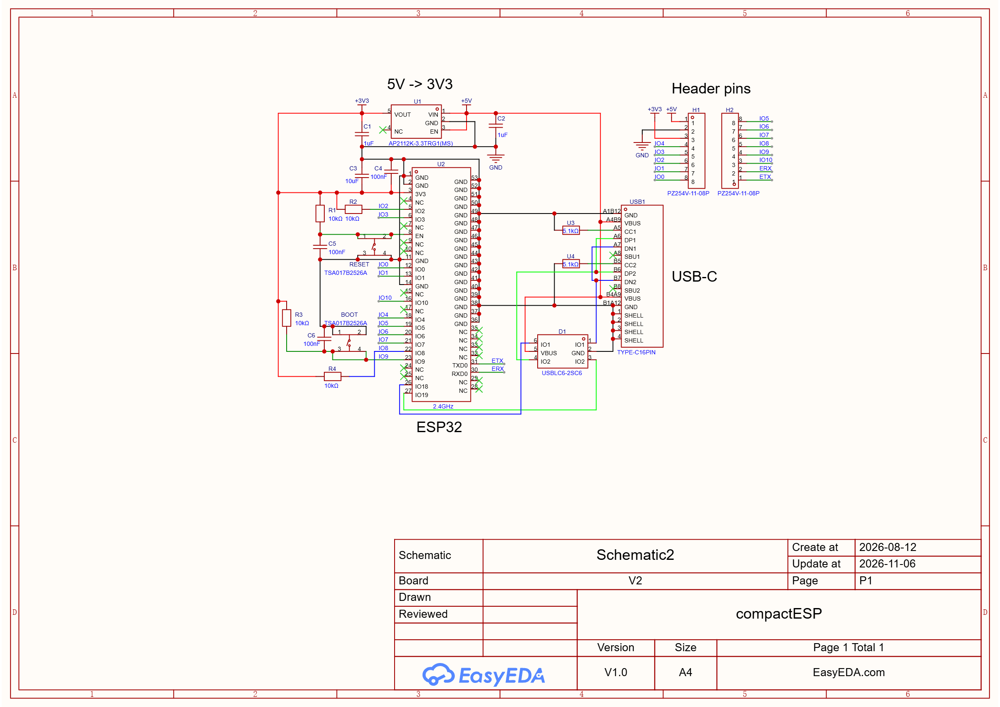

# CompactESP

A tiny, USB-C powered **ESP32-C3** breakout board built around the **ESP32-C3-MINI-1-H4** module. It was designed as a trial project: the goal was a minimal, correct "bare module" wiring with the useful GPIOs brought out to two 1×8 pin headers, and nothing else on the board.

**Board size: 25.214 mm × 21.590 mm** (the front of the USB-C connector and the module's antenna, which overhangs the board edge, are *not* included). It fits in the palm of a hand, so it is easy to carry around and drop into small prototypes (even breadboard compatible!).

## Features

- **ESP32-C3-MINI-1-H4** module: 32-bit RISC-V single core (up to 160 MHz), 2.4 GHz Wi-Fi (802.11 b/g/n) and Bluetooth 5 (LE), 4 MB flash in the chip package, on-board PCB antenna, -40 to +105 °C ambient rating
- **USB-C connector wired straight to the chip's native USB Serial/JTAG controller** (GPIO18 = D-, GPIO19 = D+): flashing, serial console and JTAG debugging over a single cable, no USB-UART bridge chip
- **USBLC6-2SC6** ESD protection on the USB data lines
- **AP2112K-3.3** LDO (600 mA) generates the 3.3 V rail from USB VBUS
- **RESET** and **BOOT** tactile buttons
- **11 GPIOs** (IO0-IO10) plus the module's UART0 pins (ETX / ERX) on 2.54 mm headers, together with +5V, 3V3 and GND
- 25.214 × 21.590 mm, no components other than what the module strictly needs

## Pinout
Matches the ESP32-C3-SUPERMINI pinout.

### Power and GPIO

| Pin | Net | Notes |
|----:|-----|-------|
| 1 | **+5V** | Directly connected to USB VBUS and to the LDO input |
| 2 | **GND** | |
| 3 | **3V3** | LDO output (600 mA total, shared with the module) |
| 4 | **IO4** | GPIO4, ADC1_CH4, JTAG MTMS |
| 5 | **IO3** | GPIO3, ADC1_CH3 |
| 6 | **IO2** | GPIO2, ADC1_CH2, **strapping pin**, 10 kΩ pull-up to 3V3 (R2) |
| 7 | **IO1** | GPIO1, ADC1_CH1 |
| 8 | **IO0** | GPIO0, ADC1_CH0 |

### GPIO and UART0

| Pin | Net | Notes |
|----:|-----|-------|
| 1 | **ETX** | GPIO21, U0TXD (the ROM bootloader prints its log here) |
| 2 | **ERX** | GPIO20, U0RXD |
| 3 | **IO10** | GPIO10 |
| 4 | **IO9** | GPIO9, **strapping pin / BOOT button**, 10 kΩ pull-up (R3) + 100 nF to GND (C6) |
| 5 | **IO8** | GPIO8, **strapping pin**, 10 kΩ pull-up to 3V3 (R4) |
| 6 | **IO7** | GPIO7, JTAG MTDO |
| 7 | **IO6** | GPIO6, JTAG MTCK |
| 8 | **IO5** | GPIO5, ADC2_CH0, JTAG MTDI |

GPIO18 and GPIO19 are used by the USB connector and are **not** available on the headers.

### Pins to be careful with

| GPIO | Why |
|------|-----|
| **IO9** | Strapping pin. Low at reset = download mode. Shared with the BOOT button. |
| **IO8** | Strapping pin. Must be high at reset (pulled up on the board). IO8 = 0 together with IO9 = 0 is an invalid combination. |
| **IO2** | Strapping pin. Pulled up on the board; keep it high at reset. |
| **IO4-IO7** | Default JTAG pins (MTMS, MTDI, MTCK, MTDO). They behave as normal GPIOs unless you use an external JTAG probe. |

> Because IO2, IO8 and IO9 have 10 kΩ pull-ups on the board, whatever you connect to them must not pull them low during reset/power-up

### Power

- **There is no fuse, reverse-polarity or back-feed protection between VBUS and the +5V header pin.** Power the board either from USB *or* from the +5V pin, never both at the same time!
- The 3V3 pin can power small external loads, but the 600 mA of the LDO is shared with the module (Wi-Fi/BLE transmit bursts included).

### USB

- 16-pin USB-C receptacle, **USB 2.0 only** (full speed, 12 Mbit/s). CC1 and CC2 each have a 5.1 kΩ pull-down to GND, so a USB-C host/charger will provide 5 V.
- Both D+ pins (A6/B6) and both D- pins (A7/B7) are tied together, so the cable can be plugged in either way.
- The data lines go through a USBLC6-2SC6 ESD array to GPIO19 (D+) and GPIO18 (D-). The chip enumerates as an **Espressif USB JTAG/serial debug unit** (VID `0x303A`, PID `0x1001`).

## Getting started: programming

- In your IDE, the board shows up as a *USB JTAG/serial debug unit* (a CDC serial port).
- To get `Serial` output on USB from Arduino code you must enable **USB CDC On Boot**.
- The very first flash, or a recovery flash needs manual BOOT mode setting.

### Entering download mode (BOOT + RESET)

1. **Hold** BOOT
2. **Plug in** the USB cable while holding BOOT
3. **Release** BOOT
### Arduino IDE

**1. Install the ESP32 core**

1. Open *File → Preferences*
2. Add this to *Additional boards manager URLs*:
   ```
   https://espressif.github.io/arduino-esp32/package_esp32_index.json
   ```
3. Open *Tools → Board → Boards Manager*, search for **esp32** and install **"esp32 by Espressif Systems"**.

**2. Select the board and options (*Tools* menu)**

| Setting | Value |
|---------|-------|
| **Board** | **ESP32C3 Dev Module** |
| **USB CDC On Boot** | **Enabled** (required for `Serial` over USB) |

**3. Test sketch**

The board has no on-board LED. Connect an LED with a series resistor to IO4 (or change `LED_PIN`).

```cpp
constexpr uint8_t LED_PIN = 4;

void setup() {
  Serial.begin(115200);
  Serial.println("START");
}

void loop() {
  Serial.println("Hello!");
  delay(1000);
}
```

### PlatformIO

Create a project with *Board: Espressif ESP32-C3-DevKitM-1* and the *Arduino* framework, or use this `platformio.ini`:

```ini
[env:compactesp]
platform  = espressif32
board     = esp32-c3-devkitm-1
framework = arduino

monitor_speed = 115200
upload_speed  = 921600

build_flags =
    -DARDUINO_USB_MODE=1          ; native USB Serial/JTAG (Hardware CDC)
    -DARDUINO_USB_CDC_ON_BOOT=1   ; Serial = USB CDC

; board_build.flash_mode = dio    ; uncomment if the board fails to boot with the default
; upload_port  = COM5             ; optional, otherwise auto-detected
; monitor_port = COM5
```

Build, flash and monitor:

```bash
pio run                 # build
pio run -t upload       # flash
pio device monitor      # serial monitor over USB CDC
```

## Troubleshooting

| Symptom | Fix |
|---------|-----|
| No serial port appears | Try another **data-capable** USB-C cable, then use BOOT + RESET. On older Windows versions you may need the Espressif USB/JTAG driver. |
| "Failed to connect... Timed out waiting for packet header" | Enter [download mode](#entering-download-mode-boot--reset) manually, then upload. |
| Upload works, but Serial Monitor shows nothing | Enable **USB CDC On Boot** (`-DARDUINO_USB_CDC_ON_BOOT=1`), re-open the monitor after reset. |
| Port disappears after your sketch starts | The sketch disabled/reconfigured USB (GPIO18/19), or went into deep sleep. Use BOOT + RESET to re-flash. |
| Board does not boot / boot loop after flashing | Try *Flash Mode: DIO*. Check that nothing on the headers pulls IO2/IO8 low (or IO9 low) at reset. |
| Brown-outs / random resets under Wi-Fi load | Use a USB port or cable that can supply enough current; keep the 3V3 header load small. |
| Poor Wi-Fi range | Keep metal and wires away from the module's antenna end. |

## Design notes and limitations

- **Trial board:** it deliberately contains only the minimum around the module. There is no battery connector or charger, no on-board LED and no user button other than BOOT (IO9, which you can also read as a normal input after boot).
- **No power protection** between USB VBUS and the +5V header pin (see [Power](#power)).
- **USB pins (GPIO18/19) are not broken out** and the USB connector is the only programming interface; there is no UART programming header (ETX/ERX on H2 can still be used for a UART connection to external devices).
- **Module availability:** Espressif lists the `-H4` (chip revision v0.4) as *NRND* (not recommended for new designs); the `-H4X` (chip revision v1.1, same 13.2 × 16.6 × 2.4 mm size, same 4 MB flash and 105 °C rating) is the recommended replacement. Check the datasheet and footprint before swapping it in a future revision.
- The LDO is rated for 600 mA; for heavy loads or battery operation a different supply concept is advisable.

## References

- [ESP32-C3-MINI-1 / MINI-1U datasheet (Espressif)](https://documentation.espressif.com/esp32-c3-mini-1_datasheet_en.html)
- [Arduino-ESP32: ESP32-C3-DevKitM-1 board page (pin functions, strapping pins)](https://docs.espressif.com/projects/arduino-esp32/en/latest/boards/ESP32-C3-DevKitM-1.html)
- [Arduino-ESP32: troubleshooting (USB CDC, download mode)](https://docs.espressif.com/projects/arduino-esp32/en/latest/troubleshooting.html)
- [ESP-IDF: USB Serial/JTAG Controller Console (ESP32-C3)](https://docs.espressif.com/projects/esp-idf/en/release-v5.0/esp32c3/api-guides/usb-serial-jtag-console.html)
- [AP2112 datasheet (Diodes Inc.)](https://www.diodes.com/assets/Datasheets/AP2112.pdf)
- [PlatformIO: ESP32-C3-DevKitM-1 board](https://docs.platformio.org/en/latest/boards/espressif32/esp32-c3-devkitm-1.html)

## Schematic
